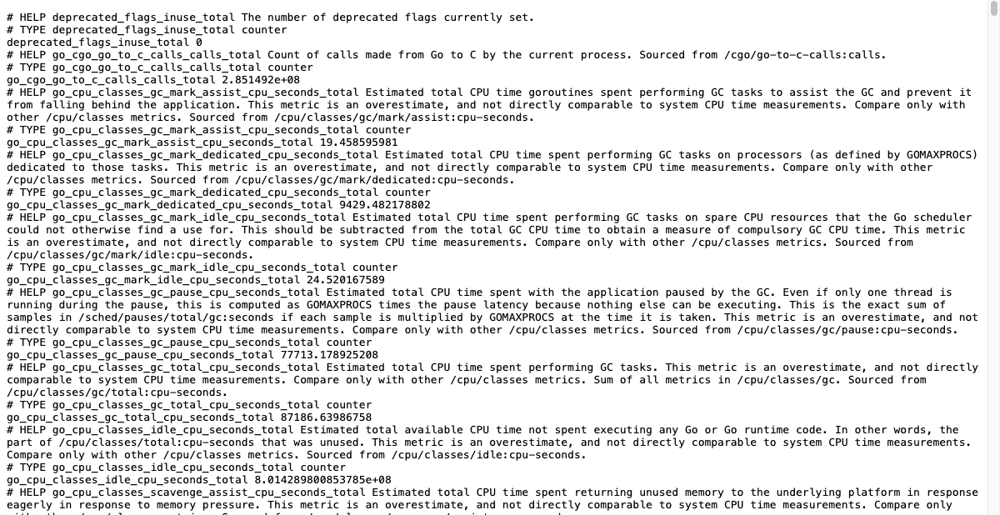
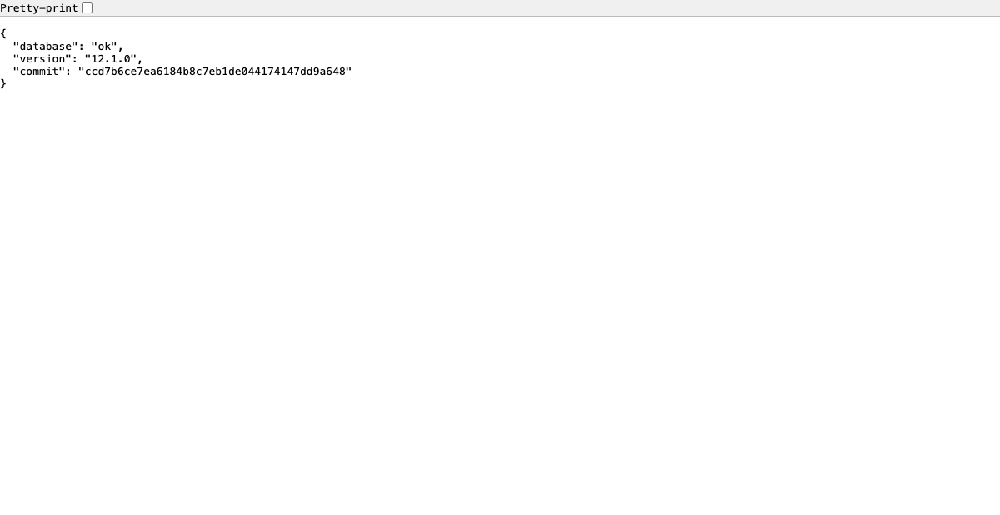
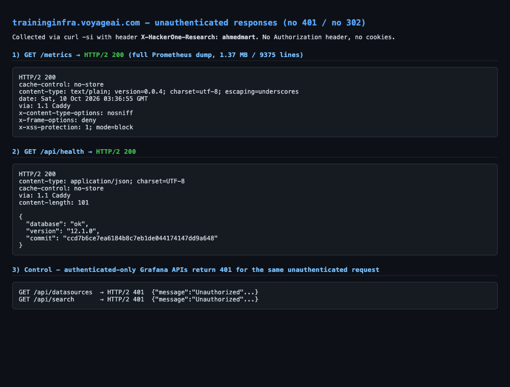

# Internal MongoDB (Voyage AI) Grafana Instance Exposed to the Public Internet — No Authentication Required

| | |
|---|---|
| Target | `traininginfra.voyageai.com` (MongoDB / Voyage AI training infrastructure) |
| Weakness | CWE-200: Sensitive Information Disclosure, CWE-400: Uncontrolled Resource Consumption |
| Component | Grafana OSS 12.1.0 (commit `ccd7b6ce7ea6`) |

## Summary
An internal Grafana monitoring instance belonging to Voyage AI's training
infrastructure is directly reachable from the public internet and serves
its Prometheus `/metrics` endpoint with **no authentication whatsoever**.

The unauthenticated response (1.37 MB, 9,375 lines) discloses operational
telemetry normally gated behind a login, including:
- Internal datasource identifiers and query volumes (`Prometheus`, `Prometheus_Jobs` — consistent with GPU/training-job monitoring)
- Authentication activity counters (592,042 successful session authentications, failed login counts)
- An enumerated map of internal Grafana API routes actively in use, including service-account token endpoints and admin routes (`/api/admin/users/:id/password`)
- Alertmanager configuration state and active notification integrations
- Build/version metadata and 228 enabled feature toggles

No hard credentials (passwords, tokens, API keys) were observed in the
dump — the exposure is operational telemetry, not credential disclosure.

A control test against authenticated-only Grafana APIs (`/api/datasources`,
`/api/search`) on the same host correctly returns `401`, confirming this
exposure is anomalous rather than a general "everything is public"
misconfiguration.

## Proof of Concept

**1. Unauthenticated metrics endpoint — full Prometheus dump, no auth challenge:**



```bash
curl -si https://traininginfra.voyageai.com/metrics
```
→ `HTTP/2 200`, `content-type: text/plain; version=0.0.4`, ~1.37 MB body,
9,375 lines. No `401`, no `302` redirect, no `WWW-Authenticate` challenge.

**2. Corroborating health endpoint confirms the exact build:**



```bash
curl -si https://traininginfra.voyageai.com/api/health
```
→ `HTTP/2 200`, `{"database":"ok","version":"12.1.0","commit":"ccd7b6ce7ea6184b8c7eb1de044174147dd9a648"}`

**3. Control test — confirms the exposure is anomalous, not a blanket misconfiguration:**



```bash
curl -si https://traininginfra.voyageai.com/api/datasources
curl -si https://traininginfra.voyageai.com/api/search
```
→ Both correctly return `HTTP/2 401 {"message":"Unauthorized"}`.

**4. Secondary observation (not exploited) — Public Dashboards feature enabled:**
```bash
curl -si https://traininginfra.voyageai.com/api/public/dashboards/invalid-token
```
→ `HTTP 400` (invalid token) rather than `401` — confirms the Public
Dashboards feature is enabled and reachable pre-auth. No valid token was
obtained or used; no exploitation of this feature is claimed.

## Second finding: pre-authentication unbounded request body (CWE-400)
Follow-up testing found that the public dashboard query handler processes
a request body in full, with **no size limit enforced**, before any token
validation occurs:

```bash
POST /api/public/dashboards/invalid-token/panels/1/query
```
→ `HTTP 400 {"messageId":"publicdashboards.invalidAccessToken"}` — not
`401`, and not `413` even at a 49,042-byte body.

Control endpoints on the same host (`/api/datasources`, `/api/search`,
`/api/admin/settings`, `/api/user`,
`/api/alertmanager/grafana/api/v2/status`, `/api/serviceaccounts/search`)
all correctly return `401`, confirming this is specific to this one
unauthenticated handler, not a general misconfiguration.

All testing was non-destructive: no payload over 50 KB, 2+ second delay
between requests, zero 5xx responses, target remained fully operational
throughout, no user data accessed.

## Impact
- **Infrastructure fingerprinting:** exact product/version/commit, Go runtime version, and 228 enabled feature toggles — enabling precise, version-targeted exploit selection.
- **Internal topology mapping:** datasource names/types and relative query volumes indicating this instance monitors AI/GPU training infrastructure.
- **Attack-surface enumeration:** a live map of internal API routes actively receiving traffic, including sensitive routes like `/api/serviceaccounts/:serviceAccountId/tokens` and `/api/admin/users/:id/password` — significantly shortening reconnaissance time for a follow-on attack.
- **Operational intelligence:** authentication volume and Alertmanager configuration state, usable to time an attack to blend in with normal traffic or gauge alerting coverage before acting.
- **Pre-auth resource-exhaustion precondition:** an unauthenticated, unbounded-body handler on an EOL Grafana build, reachable with no account, token, or session.

## Remediation
- Require authentication on `/metrics` (or disable anonymous access), consistent with Grafana's metrics-auth configuration.
- Restrict the instance to the internal network / VPN / identity-aware proxy.
- Upgrade Grafana to a current patched release; review the Public Dashboards feature flag and ensure direct-mode datasources are converted to proxied mode.
- Cap request body size at the reverse proxy (Caddy) layer for all unauthenticated handlers, independent of the Grafana-level fix.

  ##4102179 ID on Hackerone
